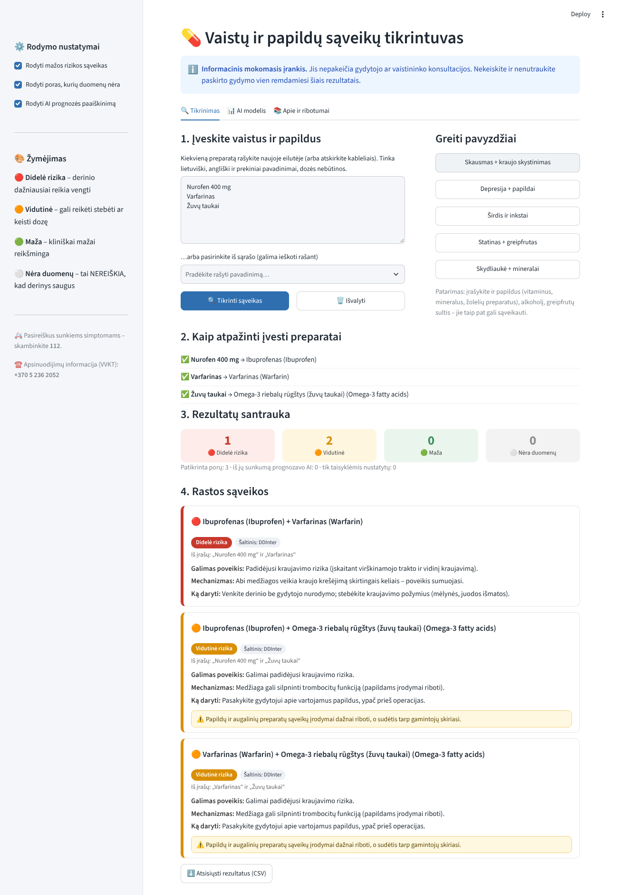

# 💊 Vaistų ir papildų sąveikų tikrintuvas

Programėlė pagal įvestą vaistų ir papildų sąrašą (lietuviškais, angliškais ar prekiniais
pavadinimais) nustato veikliąsias medžiagas, randa potencialiai pavojingus derinius ir
paaiškina galimus šalutinius poveikius. Kai informacijos nėra arba ji netiksli,
programėlė aiškiai įspėja naudotis atsargiai.

> ⚠️ **Informacinis mokomasis įrankis.** Jis nepakeičia gydytojo ar vaistininko konsultacijos.



---

## Greitas paleidimas

```bash
python -m venv .venv && source .venv/bin/activate     # Windows: .venv\Scripts\activate
pip install -r requirements.txt
streamlit run app.py                                   # atsidaro http://localhost:8501
```

Apdoroti duomenys ir apmokytas modelis jau yra repozitorijoje. Norint viską atkurti nuo nulio:

```bash
python -m src.data_prep     # DDInter CSV -> data/processed/   (~5 s)
python -m src.train         # eksperimentai, grafikai, modelis   (~4 min)
python -m pytest -q         # 18 testų
```

Docker:

```bash
docker build -t saveikos . && docker run -p 8501:8501 saveikos
```

---

## 1. Projekto klasifikavimas (privalomas pradinis etapas)

| Kriterijus | Atsakymas | Poveikis sprendimams |
|---|---|---|
| Duomenų pobūdis | **Struktūruoti lenteliniai duomenys** (vaistų poros, ATC grupės) + trumpas **tekstas** (įvesti pavadinimai) | pandas, scikit-learn, LightGBM; tekstui – taisyklės ir neraiškusis palyginimas (rapidfuzz), sunkūs NLP modeliai nereikalingi |
| Duomenų šaltinis | **Atviras duomenų rinkinys** (DDInter) + nedidelis rankinis literatūros papildymas | Realių žmonių duomenys nerenkami, anonimizavimo nereikia |
| Realus laikas | **Ne griežtas**, bet interaktyvus (atsakas < 1 s) | Lengvas medžių modelis, prognozė ~ms |
| Aparatūra | **Nėra** (grynai programinis) | – |
| Sprendimo kritiškumas | **Informacinis** (pataria) | Jokių automatinių veiksmų; visur įspėjimai ir nukreipimas pas specialistą |

## 2. Duomenys

| Šaltinis | Apimtis | Paskirtis |
|---|---|---|
| DDInter (v1 atsisiuntimai, 14 ATC failų) | 234 981 unikali pora, 1 971 medžiaga | Pagrindinė sąveikų bazė |
| ↳ su žinomu sunkumu | Major 39 082 · Moderate 143 748 · Minor 9 736 | AI modelio mokymas |
| ↳ sunkumas nežinomas („Unknown“) | 42 415 | AI modelio taikymas programėlėje |
| Rankinė žinių bazė (`src/knowledge.py`) | 22 rizikos klasės, 13 porinių taisyklių + 1 trijų vaistų taisyklė, 249 LT pavadinimai, 128 prekiniai ir 37 buitiniai pavadinimai | Paaiškinimai, LT atpažinimas |
| Literatūros įrašai | Greipfrutų sultys (11 porų), kofermentas Q10 | Medžiagos, kurių DDInter neturi |

Valymas: dublikatų šalinimas, porų simetrizavimas (A,B)=(B,A), konfliktuojantiems
lygiams imamas griežčiausias. 1-o lygio ATC grupės išvedamos iš to, kuriuose ATC failuose
yra vaisto poros (žr. `src/data_prep.py`). Duomenų pasiskirstymas – `reports/figures/01_*.png`,
`02_*.png`. Klasės nesubalansuotos (Minor tik 5 %).

## 3. Sistemos architektūra

```
 Vartotojo tekstas ──► [matching.py]  valymas → tikslus/LT kamieno/fuzzy atitikmuo
                                       │ (EN, LT, prekiniai, buitiniai pavadinimai)
                                       ▼
                         Veikliųjų medžiagų sąrašas
                                       │
            ┌──────────────────────────┼─────────────────────────────┐
            ▼                          ▼                             ▼
   DDInter paieška             Taisyklės (features.py)       Sąrašo lygmens patikros
   (Major/Moderate/Minor)      šalutinis poveikis,           dvigubas dozavimas,
            │                  mechanizmas, patarimas        „trigubas smūgis“ inkstams
            ▼ jei „Unknown“
   LightGBM + SHAP (models/)
            │
            └──────────► [checker.py] įspėjimų generavimas ──► [app.py] Streamlit UI
```

| Failas | Paskirtis |
|---|---|
| `app.py` | Streamlit sąsaja (tikrinimas, modelio rezultatai, apie) |
| `src/data_prep.py` | DDInter → `data/processed/` |
| `src/knowledge.py` | Rizikos klasės, taisyklės, LT ir prekiniai pavadinimai |
| `src/matching.py` | Pavadinimų atpažinimas |
| `src/features.py` | Taisyklių variklis ir modelio požymiai |
| `src/train.py` | Eksperimentai, metrikos, grafikai, galutinis modelis |
| `src/checker.py` | Tikrinimo logika ir įspėjimai |
| `tests/` | pytest testai |

## 4. Modelis

**Užduotis:** pagal vaistų poros požymius prognozuoti sąveikos sunkumą (3 klasės).

**Požymiai (62):** abiejų vaistų ATC grupės, farmakologinės rizikos klasės, suveikusios
taisyklės, vietinio vartojimo forma, papildo žymė ir vaisto „istorija“ (sąveikų skaičius,
Major/Minor dalis). Istorijos požymiai mokymo eilutėms skaičiuojami **out-of-fold** (5 dalys),
kad nebūtų tikslo nutekėjimo.

**Pasirinkimo pagrindimas** (pagal metodinių nurodymų hierarchiją): duomenų > 5000, bet jie
lenteliniai, todėl gilieji tinklai nėra pranašesni – pasirinktas gradientinio stiprinimo
modelis **LightGBM**. Hiperparametrai: `learning_rate=0.05`, `num_leaves=63`,
`min_child_samples=30`, `feature_fraction=0.8`, `bagging_fraction=0.8`, `lambda_l2=1`,
ankstyvas sustabdymas po 50 iteracijų be pagerėjimo (validacijos imtis – 10 % mokymo).
Paaiškinamumas: integruotas **TreeSHAP** (`pred_contrib=True`) – grafikas
`07_shap_svarbiausi.png` ir paaiškinimas kiekvienai prognozei programėlėje.

## 5. Eksperimentai (Baseline vs Proposed)

Pilna lentelė: `reports/metrics_table.md`, `reports/metrics.json`.

**1 eksperimentas – atsitiktinis porų padalijimas 80/20**

| Modelis | Accuracy | F1 (macro) | F1 (weighted) | F1 Minor | F1 Major |
|---|---|---|---|---|---|
| B0: dažniausia klasė | 0.746 | 0.285 | 0.638 | 0.000 | 0.000 |
| B1: taisyklės | 0.752 | 0.306 | 0.652 | 0.000 | 0.061 |
| B2: logistinė regresija | 0.521 | 0.431 | 0.569 | 0.201 | 0.471 |
| **P: LightGBM** | **0.888** | **0.789** | **0.885** | **0.654** | **0.787** |
| P: LightGBM (subalansuoti svoriai) | 0.837 | 0.751 | 0.846 | 0.608 | 0.757 |

**2 eksperimentas – nauji vaistai** (10 % vaistų visai neįtraukti į mokymą): LightGBM
macro F1 **0.583** (accuracy 0.761), logistinė regresija 0.422.

**Interpretacija.** Tikslumas (accuracy) čia klaidina: vien „Moderate“ spėjimas duoda 74,6 %,
todėl pagrindinė metrika yra **macro F1**. LightGBM ją pagerina beveik 3 kartus, palyginti su
B0. Svarbiausi požymiai – vaistų sąveikų istorija ir ATC grupės. Taisyklės (B1) kaip
klasifikatorius silpnos, nes suveikia tik ~4 % porų, tačiau kai jos numato „Major“, DDInter
sutampa 84 % atvejų, todėl jos naudingos paaiškinimams. Subalansuoti svoriai padidino Minor
recall, bet sumažino precision ir macro F1.

**Nesėkmės ir ribotumai**
- Su naujais vaistais modelis gerokai silpnesnis (0,58 vs 0,79) – jis daug „mokosi“ iš
  vaisto istorijos.
- Konkretus klaidos pavyzdys: *furozemidas + kalio chloridas* prognozuojamas kaip „Major“
  (93 %), nors kliniškai šis derinys dažnai skiriamas sąmoningai. Priežastis – kalio
  chloridas turi daug „Major“ sąveikų, ir modelis tai perkelia į šią porą. Todėl programėlėje
  kiekviena AI prognozė žymima „AI prognozė – naudokite atsargiai“.
- 44 % Minor porų klasifikuojamos kaip Moderate (konfuzijos matrica `04_*.png`).

## 6. Įspėjimų logika („naudoti atsargiai“)

| Situacija | Rodoma |
|---|---|
| Neatpažintas pavadinimas / medžiagos DDInter nėra (pvz., metamizolas) | ❌ / ⛔, sąveikos netikrintos |
| Apytikslis atpažinimas | 🟡 + prašymas patikrinti |
| Neaiškus įrašas | ❓ + pasiūlymų sąrašas |
| Sunkumą prognozavo AI | ⚠️ ženkliukas „AI prognozė“, tikimybės, SHAP |
| AI tikimybė < 60 % | ⚠️ „modelis nėra tikras“ |
| Sąveika tik pagal taisykles | ⚠️ „galima, o ne patvirtinta sąveika“ |
| DDInter ir taisyklės nesutaria | ⚠️ rodomas griežtesnis vertinimas |
| Nėra mechanizmo aprašymo | ⚠️ siūloma tikrinti pakuotės lapelyje / pas vaistininką |
| Dalyvauja papildas | ⚠️ įrodymai riboti |
| Poros duomenų nėra | ⚪ „tai NEREIŠKIA, kad derinys saugus“ |

## 7. Etika, sauga ir privatumas

- Asmens duomenys **nerenkami ir nesaugomi**; naudojami tik vieši duomenų rinkiniai.
- Sprendimo kritiškumas – **informacinis**: jokių automatinių veiksmų, nuolatinis
  priminimas kreiptis į specialistą, nurodyti pagalbos telefonai (112; VVKT apsinuodijimų
  informacija +370 5 236 2052).
- Rizika: vartotojas gali klaidingai interpretuoti „nėra duomenų“ kaip „saugu“ – todėl tai
  aiškiai paneigiama kiekviename rezultate.
- Komercinės uždaro kodo API nenaudojamos – viskas veikia neprisijungus (offline).

## 8. Ribotumai

DDInter v1 neturi mechanizmų tekstų; neįvertinamos dozės, amžius, inkstų ir kepenų funkcija;
dalies LT populiarių medžiagų bazėje nėra; prekinių pavadinimų sąrašas nepilnas; atskirų
vaistų šalutiniai poveikiai (SIDER) neįtraukti – rodomi tik derinių galimi poveikiai;
ATC grupės išvestos netiesiogiai.

## 9. Literatūra

1. Xiong G. ir kt. DDInter: an online drug–drug interaction database towards improving clinical decision-making and patient safety. *Nucleic Acids Research*, 2022, 50(D1):D1200–D1207.
2. DDInter 2.0: an enhanced drug interaction resource with expanded data coverage, new interaction types, and improved user interface. *Nucleic Acids Research*, 2025, 53(D1):D1356.
3. Phansalkar S. ir kt. High-priority drug–drug interactions for use in electronic health records. *JAMIA*, 2012, 19(5):735–743.
4. Phansalkar S. ir kt. Criteria for assessing high-priority drug-drug interactions for clinical decision support in electronic health records. *BMC Med Inform Decis Mak*, 2013, 13:65.
5. Kuhn M. ir kt. The SIDER database of drugs and side effects. *Nucleic Acids Research*, 2016, 44(D1):D1075–D1079.
6. Bailey D.G. ir kt. Grapefruit–medication interactions: forbidden fruit or avoidable consequences? *CMAJ*, 2013, 185(4):309–316.
7. Ke G. ir kt. LightGBM: A Highly Efficient Gradient Boosting Decision Tree. *NeurIPS*, 2017.
8. Lundberg S.M., Lee S.-I. A Unified Approach to Interpreting Model Predictions (SHAP). *NeurIPS*, 2017.

## 10. Priedai

- GitHub: *(įrašykite savo repozitorijos nuorodą)*
- Ekrano nuotraukos: `docs/screenshots/`
- Visi grafikai: `reports/figures/`
